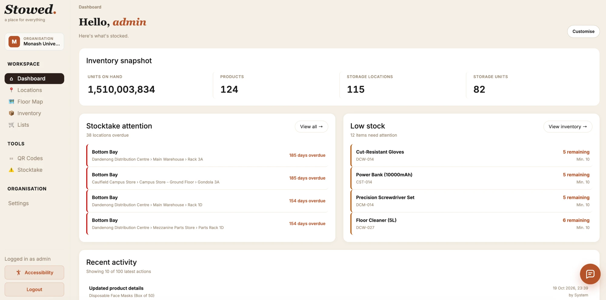
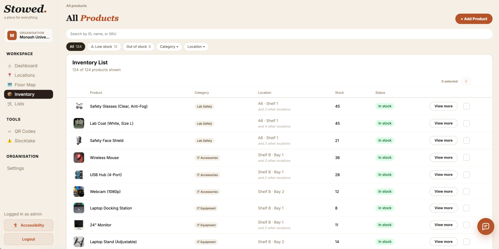
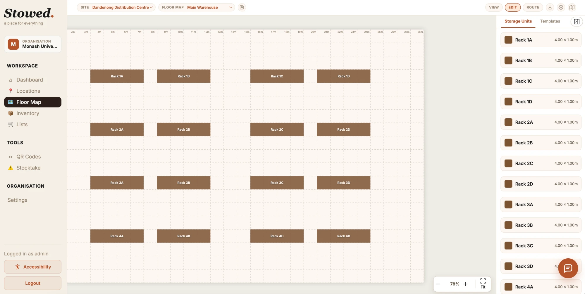
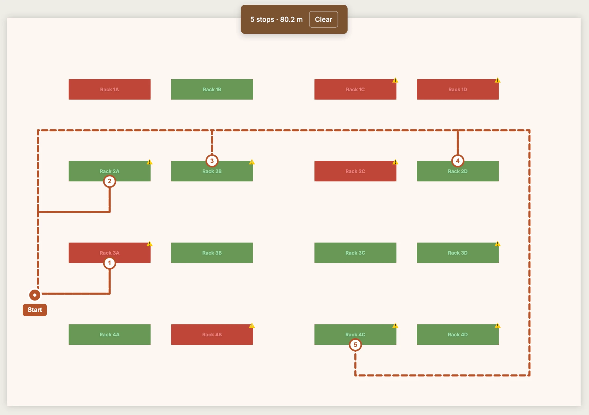
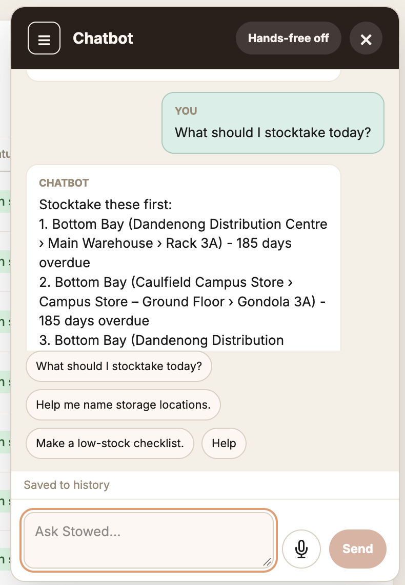
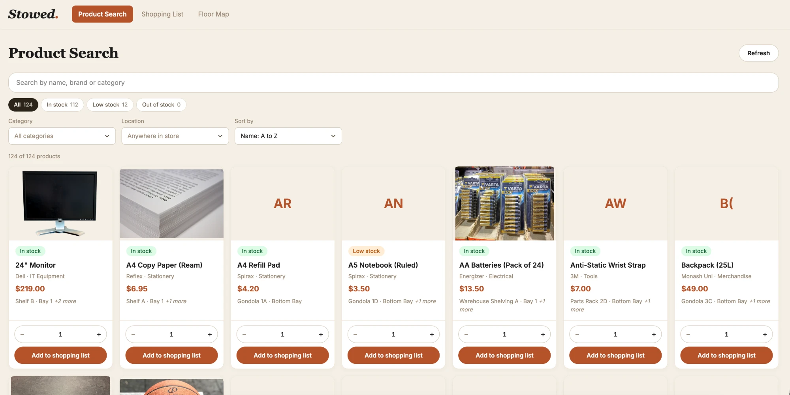

# Stowed

**Stowed** is an inventory and stock management web app for small businesses, built with [Meteor](https://www.meteor.com/) and React. Staff can map their shop floor and storerooms, track exactly where every product is stored, keep stock counts accurate with QR/barcode scanning and scheduled stocktakes, and get the shortest restocking path around the floor. Customers can use a public, mobile-friendly view to search products, build a shopping list and get directions to items in store. An AI assistant (with voice and hands-free mode) can answer questions and carry out actions across the app.

- **Live demo:** shut down. Redeploying needs new accounts and keys (e.g. Meteor Galaxy and the other service keys), and the `deploy` job in `.github/workflows/ci.yml` is disabled until then.
- **Repository:** https://github.com/Monash-FIT3170/2026W1-Stowed
- **Issue tracker:** https://github.com/Monash-FIT3170/2026W1-Stowed/issues

This document is the handover guide for developers joining the project. It covers what you need to install, how to run, test and deploy the app, how the code is organised, and how to contribute.

## Contents
1. [Features](#1-features)
2. [Tech stack](#2-tech-stack)
3. [Requirements](#3-requirements)
4. [Getting started](#4-getting-started)
5. [Environment variables](#5-environment-variables)
6. [Architecture](#6-architecture)
7. [Naming conventions](#7-naming-conventions)
8. [CI/CD and deployment](#8-cicd-and-deployment)
9. [Branching and pull request strategy](#9-branching-and-pull-request-strategy)
10. [Versioning strategy](#10-versioning-strategy)
11. [Troubleshooting](#11-troubleshooting)
12. [Risks and costs](#12-risks-and-costs)
13. [Suggested next steps](#13-suggested-next-steps)
14. [Team](#14-team)

---

## 1. Features

| Area | Features |
|---|---|
| **Inventory management** | Product create/edit/delete, product photos, search and filtering, categories, product lookup from the web (SerpAPI) to prefill new products, CSV import and full inventory export, multi-location stock (one product across many storage locations) |
| **Shop floor mapping** | Sites → floor maps → storage units → storage locations; drag-and-drop floor map editor with custom shapes, grid snapping and walkways; shortest restocking/picking path |
| **Stock monitoring** | Minimum-stock alerts, scheduled stocktakes with due/overdue status, recurring schedules, dashboard activity feed |
| **Scanning** | Generate QR codes for locations and barcodes for products; scan with a device camera to look up or adjust stock, or to add products to a floor map route |
| **Shopping lists** | Build lists (including from low-stock items), share by email, mark stock as received and allocate it to a location |
| **Access** | Organisations with role-based permissions (Standard / Admin / Owner), email verification and password reset |
| **AI assistant** | Gemini-powered chatbot that can search products, create lists/units/users, navigate the app and give in-store directions; speech-to-text, text-to-speech and hands-free mode |
| **Customer mode** | Public mobile view per organisation (`/org/:orgCode`): product search, shopping list and floor map with directions |
| **Onboarding & accessibility** | Beginner tutorial, mobile/tablet layouts, accessibility settings |

### Screenshots

| Dashboard | Inventory |
|---|---|
|  |  |
| **Floor map editor** | **Restocking route** |
|  |  |
| **AI assistant** | **Customer mode** |
|  |  |

---

## 2. Tech stack

| Layer | Technology |
|---|---|
| Framework | Meteor `3.4.1` (bundled with Rspack), Node.js |
| Front end | React 18, React Router 7, Tailwind CSS v4 (+ per-page `.css` files) |
| Database | MongoDB (managed by Meteor locally) with `simpl-schema` + `collection2` validation |
| Floor map | `konva` / `react-konva`, `poly-decomp-es` |
| Scanning | `html5-qrcode` (camera scanning), `qrcode`, `jsbarcode` |
| External services | Resend (email), Google Gemini via `@google/genai` (chatbot), SerpAPI (product lookup) |
| Testing & quality | Mocha (`meteortesting:mocha`), ESLint 9, Prettier 3 |
| CI/CD & hosting | GitHub Actions, Meteor Galaxy (free tier) |

---

## 3. Requirements

### Software
| Requirement | Version / notes |
|---|---|
| **Node.js** | v20+ recommended (CI uses Node 22) – [download](https://nodejs.org/) |
| **Meteor** | `3.4.1` (pinned in `Stowed/.meteor/release`). Install with `npm install -g meteor` or the [official installer](https://www.meteor.com/install). |
| **MongoDB** | No manual install – Meteor runs a local MongoDB in development. |
| **Git** | Any recent version. |
| **Browser** | Recent Chrome / Edge / Firefox. Camera access is needed for scanning, microphone access for voice mode. |
| **API keys (optional)** | Resend, Gemini and SerpAPI – only needed for email, the chatbot and product lookup respectively. See [Environment variables](#5-environment-variables). |

### Hardware
- Any laptop/desktop that can run Node.js and Meteor.
- A webcam (or phone) to test camera scanning (`ScanPage`, `ScanUpdatePage`). A USB/Bluetooth barcode scanner that acts as a keyboard also works. Generating codes (`QRCodesPage`) needs no camera.
- A microphone to test chatbot voice input.

---

## 4. Getting started

> All `npm` / `meteor` commands are run from inside `Stowed/`, not the repo root. The root `package-lock.json` is a leftover placeholder.

1. **Clone and enter the app folder**
   ```bash
   git clone https://github.com/Monash-FIT3170/2026W1-Stowed.git
   cd 2026W1-Stowed/Stowed
   ```
2. **Install Meteor** (if needed): `npm install -g meteor`
3. **Install dependencies**
   ```bash
   meteor npm install
   ```
4. **Configure secrets (optional)**
   ```bash
   cp .env.example .env
   ```
   Fill in whichever keys you need (see [section 5](#5-environment-variables)). The app runs without any keys; the related features show a "not configured" error instead.
5. **Run**
   ```bash
   npm start
   ```
   The app is served at **http://localhost:3000**. The first run is slow while Meteor downloads its toolchain and MongoDB.
6. **Log in** with a seeded demo account. On startup `seedDatabase()` (`server/seed.js`) fills an empty database with a demo organisation, users, products, locations, shopping lists and schedules. Demo logins are listed in `imports/api/seedData/users.js` (e.g. `jsmith` / `monash123`, an Admin). You can also register a new organisation through the app.
   - To turn seeding off, comment out `await seedDatabase();` in `Meteor.startup` in `server/main.js`.

### Scripts (run from `Stowed/`)
| Command | What it does |
|---|---|
| `npm start` | Start the dev server (`meteor run`) |
| `npm test` | Run the Mocha test suite once |
| `npm run test:ci` | Run the server-side tests only (what CI runs) |
| `npm run test:floor-map` | Run only the floor map tests |
| `npm run test-app` | Run tests in watch mode with the full app (`TEST_WATCH=1`) |
| `npm run lint` / `npm run lint:fix` | ESLint check / autofix |
| `npm run format` / `npm run format:check` | Prettier write / check (the check runs in CI) |
| `npm run visualize` | Visualise the production bundle |

---

## 5. Environment variables

Secrets are read from `process.env`. `server/main.js` loads a `.env` file from the `Stowed/` folder with `dotenv`; `Stowed/.env.example` is the template. Some keys can also be supplied via `Meteor.settings` (`meteor run --settings settings.json`). **Never commit `.env` or real keys** – `.env` is gitignored. `settings.json` is also gitignored, but an empty `{}` copy is committed so `--settings settings.json` works; keep it empty.

| Variable | Used for | If not set |
|---|---|---|
| `GEMINI_API_KEY` | AI assistant (`imports/api/chatbot/methods.js`). `GOOGLE_API_KEY` is accepted as a fallback. | Chatbot returns a `gemini-not-configured` error. |
| `GEMINI_MODEL` | Overrides the Gemini model | Defaults to `gemini-3.5-flash-lite`. |
| `RESEND_API_KEY` | Sending emails via [Resend](https://resend.com/): shopping list sharing, email verification, password reset (`server/email/resend.js`) | Email attempts throw `resend-not-configured`. |
| `RESEND_FROM` | "From" address for emails | Defaults to `myapp@resend.dev`. |
| `SERP_API_KEY` | Product lookup when adding a product (`server/serpapi/serpapi.js`) | Product lookup throws a "SERP_API_KEY is not set" error. |
| `REQUIRE_EMAIL_VERIFICATION` | Set to `true` to require users to verify their email before logging in (`server/accounts.js`) | Verification is not required. |
| `RESET_SEED_TOKEN` | Protects the `/admin/reset-seed` endpoint that wipes and reseeds the database (`server/main.js`) | The endpoint returns 404. |

In production these are set as environment variables on the Galaxy app. GitHub Actions also needs `METEOR_SESSION`, `GALAXY_APP_URL` and `RESET_SEED_TOKEN` (see [section 8](#8-cicd-and-deployment)).

---

## 6. Architecture

### Monolith overview
Stowed is a single Meteor application – there is no separate REST back end. The client and server share code in `imports/`:

- **Collections** (MongoDB) are defined once and used on both client and server.
- **Publications** push live data from the server to the client over Meteor's DDP websocket; React components subscribe with `useTracker` / `useSubscribe` (`react-meteor-data`), so the UI updates in real time.
- **Methods** (`Meteor.callAsync("products.update", …)`) are the server's API for writes. Every method checks organisation access and calls `requirePermission(userId, "<permission>")` before changing data.

```
Browser (React UI)  ──subscribe──▶  Publications ─┐
        │                                         ├──▶ MongoDB
        └────call────▶  Methods (permission check)┘
                              │
                              └──▶ Resend · Gemini · SerpAPI
```

### Folder structure
```
2026W1-Stowed/
├── .github/workflows/      # ci.yml (lint, test, deploy), pr-rules.yml, reset-seed.yml
├── README.md
└── Stowed/                 # Meteor app root – run all commands here
    ├── .meteor/            # Meteor packages/release (managed by the meteor tool)
    ├── .env.example        # Template for secrets
    ├── client/main.jsx     # Client entry point
    ├── server/
    │   ├── main.js         # Server entry: loads .env, imports API modules, seeds DB, reset-seed route
    │   ├── accounts.js     # Accounts config, email verification rules
    │   ├── seed.js         # Demo data seeding
    │   ├── email/          # Resend client + shopping list email template
    │   ├── routes/         # Route planning: dijkstra.js, planRoute.js, methods.js
    │   └── serpapi/        # Product lookup via SerpAPI
    ├── imports/
    │   ├── api/            # Collections, schemas, methods, publications (one folder per feature)
    │   └── ui/             # React app
    │       ├── App.jsx     # Router and route guards
    │       ├── pages/      # One component per screen (+ floorMapComponents/, locationComponents/, settings/)
    │       ├── components/ # Shared components (Chatbot, Toast, StockAdjuster, voice hooks, …)
    │       ├── hooks/      # Shared React hooks
    │       ├── tutorial/   # Beginner tutorial content
    │       └── accessibility/
    ├── public/             # Static assets
    ├── tests/              # Mocha tests (entry: tests/main.js)
    └── package.json
```

### Key modules
| Module (`imports/api/…`) | Responsibility |
|---|---|
| `products/` | Products, per-location stock records, activity log, codes, search, export, stock adjust/receive, stocktake save |
| `locations/` | Sites, floor maps, storage units, shapes, storage locations, walkway route graph (`routeGraph.js`), stocktake scheduling maths (`stocktake.js`) |
| `categories/` | Product categories |
| `shoppingLists/` | Shopping lists and sharing |
| `schedules/` | Recurring stock tasks |
| `importRecords/`, `bulkImport.js` | CSV import and import history |
| `chatbot/` | Gemini integration: `methods.js`, `tools.js` (functions the model can call), `actionPermissions.js`, `directions.js`, `history.js`, `prompts.js` |
| `customer/` | Public customer catalogue for customer mode |
| `organisations.js`, `users.js`, `userMethods.js`, `roles.js` | Organisations, accounts and the permission table (`PERMISSIONS` in `userMethods.js`) |
| `seedData/` | Demo data used by `server/seed.js` |

### Pages and roles
Routes are defined in `imports/ui/App.jsx`. Roles are `STANDARD = 1`, `ADMIN = 2`, `OWNER = 3` (`imports/api/roles.js`); each permission in `PERMISSIONS` (`imports/api/userMethods.js`) names the minimum role, and the same table gates both pages (`route:/…`) and methods.

| Who | Routes |
|---|---|
| Public | `/login`, `/register`, `/verify-email/:token`, `/forgot-password`, `/reset-password/:token` |
| Staff | `/` and `/dashboard`, `/inventory` (+ `/new`, `/:productId`, `/:productId/edit`), `/floor-map` (+ `/:floorMapId`, `/:floorMapId/detail`), `/locations` (+ `/:locationId`, `/unit/:unitId`), `/scan` (+ `/settings`, `/product/:productId`), `/lists` (+ `/:listId`), `/stocktake/:locationId`, `/qr-codes`, `/alerts`, `/settings` |
| Customer | `/org/:orgCode` → `/customer/search`, `/customer/search/:productId`, `/customer/lists`, `/customer/floor-map` |

Examples: Standard staff can adjust stock, run stocktakes, plan routes and use the chatbot; Admins also manage products, locations and settings; only Owners can create and delete users.

### Data model
All documents carry an `orgId` so every query is scoped to one organisation.

```
organisations
 └── sites                     (stocktakeIntervalDays)
      └── floorMaps            (siteId, floorSize, settings, isPrivate)
           ├── storageUnits    (floorMapId, type, shape, offset, rotation, scale)
           │    └── storageLocations (storageUnitId, code, lastStocktakeAt)
           ├── mapShapes       (custom unit shapes)
           └── floorMapRoutes  (walkway nodes + links for route planning)

products            (categoryId, totalQuantity, reorderAt, images, codes)
 ├── productRecords    (productId + locationId → quantity at that storage location)
 └── productActivities (immutable history events: restock, stocktake, adjust, …)
productCategories · shoppingLists · schedules · importRecords · chatConversations
```

- A product's `totalQuantity` should equal the sum of its `productRecords` quantities.
- `productActivities` store name snapshots, so history still reads correctly after a product or location is renamed.
- Schemas live next to collections (`imports/api/*/schemas.js`) and are enforced with `collection2`.

### Floor map and routing flow
1. **Edit** – Admins draw storage units on a Konva canvas (`FloorMapPage.jsx`, `floorMapComponents/`). Units have a shape (preset or custom polygon), position, rotation and scale; grid snapping and collision checks keep them inside the floor and apart.
2. **Walkways** – Admins add walkway nodes and links, plus *product nodes* on the edge of storage units that mark where items in that unit can be picked. The graph is validated by `imports/api/locations/routeGraph.js` (shared by the editor and the save method) and stored in `floorMapRoutes`.
3. **Plan** – `server/routes/planRoute.js` runs a greedy multi-endpoint Dijkstra (`server/routes/dijkstra.js`): from the current position, walk to the nearest product node that still has something to pick, pick everything available there, repeat. This gives the shortest restocking path for staff.
4. **Directions** – the same graph powers customer directions (`DirectionsModal`, customer floor map) and the chatbot's `getDirections` tool (`imports/api/chatbot/directions.js`).

### Stocktake flow
1. Each site has a `stocktakeIntervalDays` (default 180). `imports/api/locations/stocktake.js` works out each storage location's next due date from `lastStocktakeAt` and labels it **ok**, **due soon** (within 14 days) or **overdue**. Alerts, Locations and Location detail pages all use this.
2. Staff open `/stocktake/:locationId` (or the unit stocktake panel on the floor map) and count what is actually there.
3. Saving calls `stocktake.save` (`imports/api/products/methods.js`): it updates each `productRecord`, recalculates product totals, logs a `stocktake` activity for every change and sets `lastStocktakeAt` on the location – even if nothing changed. `storageLocations.stocktakeComplete` marks a location as counted without changes.

### AI assistant
- `Chatbot.jsx` sends the conversation to the `chatbot` methods, which call Gemini with tool definitions from `tools.js` (search/get/create/update/delete products, list locations and categories, directions, create user, navigate).
- Before any action runs, `actionPermissions.js` maps it to the same permission the UI uses, so the bot can never do something the user's role couldn't.
- Conversations are stored in `chatConversations` (`history.js`).
- Voice uses the browser Web Speech API (`useSpeechRecognition.js`, `useSpeechSynthesis.js`, `voiceHelpers.js`).

---

## 7. Naming conventions

| Thing | Convention | Example |
|---|---|---|
| Pages | PascalCase, `…Page.jsx`, styles in a sibling `.css` | `StocktakePage.jsx` + `StocktakePage.css` |
| Components | PascalCase `.jsx` | `StockAdjuster.jsx` |
| Hooks | camelCase starting with `use` | `useSpeechRecognition.js` |
| API feature folders | camelCase, with `collections.js`, `schemas.js`, `methods.js`, `publications.js` | `imports/api/shoppingLists/` |
| Meteor methods | `<collection>.<action>` in camelCase | `products.adjustStock`, `sites.updateStocktakeInterval` |
| Permissions | Same as the method, or `route:/<path>` for pages | `stocktake.save`, `route:/dashboard` |
| Tests | camelCase `.test.js` in `tests/` | `routePlanning.test.js` |
| Branches | `feature/<name>`, `subfeature/<name>`, `ui/<name>` | `subfeature/shortest-routing` |
| Commits & PR titles | Conventional commits (enforced by CI) | `feat: add walkway editor` |

Formatting is handled by Prettier and linting by ESLint – run `npm run lint:fix && npm run format` before pushing.

---

## 8. CI/CD and deployment

| Workflow | Trigger | What it does |
|---|---|---|
| `ci.yml` – **Lint** | Push/PR to `main` or `develop` | `npm ci`, ESLint, Prettier check |
| `ci.yml` – **Test** | Push/PR to `main` or `develop` | Sets up Node 22 and Meteor 3.4.1, runs `npm run test:ci` (30-minute timeout) |
| `ci.yml` – **Deploy** | Push to `main`, after lint and test pass | `meteor deploy $GALAXY_APP_URL --free` to Meteor Galaxy (one deploy at a time) |
| `pr-rules.yml` | PR opened/edited/updated against `main` or `develop` | Fails if the PR title or any commit message isn't a conventional commit |
| `reset-seed.yml` | Manual (Actions → "Run workflow", type `RESET`) | Calls `/admin/reset-seed` on the deployed app to **wipe and reseed** its database |

**Required GitHub configuration**
- `secrets.METEOR_SESSION` – base64-encoded Meteor login session (`~/.meteorsession`) for an account with deploy rights to the Galaxy app.
- `vars.GALAXY_APP_URL` – the Galaxy app hostname.
- `secrets.RESET_SEED_TOKEN` – must match `RESET_SEED_TOKEN` on the Galaxy app.

**Manual deploy**
```bash
cd Stowed
meteor login
meteor deploy <your-app>.meteorapp.com --free
```
Then set the environment variables from [section 5](#5-environment-variables) on the app in the Galaxy dashboard. To refresh `METEOR_SESSION` after logging in again, base64-encode `~/.meteorsession` and update the GitHub secret.

---

## 9. Branching and pull request strategy

### Branches
```
subfeature/<task>  ──PR──▶  feature/<epic>  ──PR──▶  develop  ──release PR──▶  main  ──▶ auto-deploy
```
- **`main`** – production. Every push deploys to Galaxy. Only updated through release PRs from `develop`.
- **`develop`** – integration branch. All finished features merge here first.
- **`feature/<epic>`** – one per epic or larger feature (e.g. `feature/chatbot`, `feature/map-routing`).
- **`subfeature/<task>`** – one per task/user story, branched from its feature branch (or from `develop` for standalone work).
- Use lowercase, hyphenated names: `subfeature/walkway-editor`.

### Submitting a PR
1. **Pick or open an issue** describing the bug or feature, so the work is tracked.
2. **Branch** from the latest `develop` (or the relevant `feature/` branch):
   ```bash
   git checkout develop && git pull
   git checkout -b subfeature/<short-name>
   ```
3. **Commit** using conventional commit prefixes – CI rejects anything else:
   `feat:`, `fix:` / `bugfix:`, `style:`, `docs:`, `refactor:`, `test:`, `chore:` (optional scope, e.g. `fix(scan): …`; add `!` for breaking changes, e.g. `feat!: …`).
4. **Check locally** from `Stowed/`: `npm run lint`, `npm run format:check`, `npm test`. Add or update tests for the behaviour you changed.
5. **Open the PR** against the branch you started from, with a conventional-commit title and a description covering:
   - **What** changed and **why** (link the issue, e.g. `Closes #123`)
   - **How it was tested**
   - **Screenshots** for UI changes
   - Any new environment variables or migration steps
6. **Review** – at least one approval from another developer and green CI (lint, test, PR rules) before merging. For PRs into `develop`, post the link in the team's develop-PR review channel so a reviewer picks it up quickly.
7. **Merge** and delete the branch. Resolve conflicts by merging the latest base branch into yours, not by force-pushing over shared branches.
8. **Release** – when `develop` is stable, open a `develop → main` PR (e.g. `chore: release v1.1.0`). Merging it deploys to production. For future releases, also tag a version (see below).

---

## 10. Versioning strategy

The project has not used a versioning scheme so far – there are no release tags, and `main` has simply been updated from `develop` at each milestone. For future releases, we recommend [Semantic Versioning](https://semver.org/): **`MAJOR.MINOR.PATCH`**.

| Bump | When | Driven by commits like |
|---|---|---|
| **MAJOR** | Breaking change – data model change that needs a migration, removed feature, changed method contract | `feat!:` or a `BREAKING CHANGE:` footer |
| **MINOR** | New, backwards-compatible feature | `feat:` |
| **PATCH** | Backwards-compatible bug fix or small improvement | `fix:`, `style:`, `refactor:`, `chore:` |

**Suggested release process**
1. Merge the `develop → main` release PR.
2. Update `"version"` in `Stowed/package.json`.
3. Tag `main` and push the tag:
   ```bash
   git tag -a v1.0.0 -m "Release v1.0.0"
   git push origin v1.0.0
   ```
4. Create a GitHub Release from the tag; use "Generate release notes" so the conventional PR titles become the changelog.

The first tagged release under this scheme would be **`v1.0.0`**, marking the state of `main` at handover.

---

## 11. Troubleshooting

### Setup
| Problem | Fix |
|---|---|
| `npm start` fails or packages are missing | Make sure you are in `Stowed/`, not the repo root, then run `meteor npm install`. |
| First run takes a long time | Normal – Meteor downloads its toolchain and MongoDB once. |
| Wrong Meteor version errors | The app is pinned to 3.4.1 (`.meteor/release`). Install that release: `curl https://install.meteor.com/?release=3.4.1 \| sh`. |
| Rspack native binding errors on Windows | `@rspack/binding-win32-x64-msvc` is an optional dependency – delete `node_modules` and run `meteor npm install` again. |
| Styles disappear in the dev app after running tests | Running `meteor test` while `npm start` is running can empty the dev CSS bundle. Stop both and restart `npm start`. |
| Don't hand-edit `.meteor/` | Use `meteor add` / `meteor remove`; `release` and `versions` are managed by the meteor tool. |

### Missing environment variables
| Error | Cause |
|---|---|
| `resend-not-configured` | `RESEND_API_KEY` missing – email sharing, verification and password reset won't send. |
| `gemini-not-configured` | `GEMINI_API_KEY` missing – chatbot unavailable. |
| "SERP_API_KEY is not set" | Product lookup unavailable; products can still be added manually. |
| `/admin/reset-seed` returns 404 | `RESET_SEED_TOKEN` not set (by design). |

If a key is set but not picked up, check the file is named `.env` (not `.env.example`) inside `Stowed/`, and restart the server.

### Floor map
- Canvas errors in the console usually mean `konva` / `react-konva` / `poly-decomp-es` didn't install – re-run `meteor npm install`.
- Units are kept inside the floor bounds and snapped to the grid; if a unit won't move where you expect, check the floor size and grid settings in the floor map settings modal.
- Route planning needs a connected walkway graph with product nodes on the relevant units. If no route is found, check every product node is linked to a walkway.

### Camera and microphone
Browsers only allow the camera (scanning) and microphone (voice) on **HTTPS or `localhost`**. `http://localhost:3000` works; a LAN IP address over plain HTTP will not. Voice input relies on the Web Speech API, which works best in Chrome/Edge.

### Permissions
"unauthorized" errors usually mean the logged-in user's role is too low for that action. Check the user's role in Settings → Accounts and the minimum role in `PERMISSIONS` (`imports/api/userMethods.js`).

### Resetting the database
- **Local:** stop the server, run `meteor reset` (wipes your **local** database only), then `npm start` to reseed.
- **Deployed:** run the **Reset seed** workflow in GitHub Actions and type `RESET`. This is destructive – only use it on the demo deployment.

### Known issues
Current bugs and limitations at handover. New bugs should be raised on the [issue tracker](https://github.com/Monash-FIT3170/2026W1-Stowed/issues).

| Issue | Details | Workaround / next step |
|---|---|---|
| Uploaded images are stored on the server's disk | `imports/api/upload.js` writes product/location photos to `Stowed/Uploads/images`. On Galaxy the disk is reset on every redeploy, so uploaded images disappear. | Move uploads to object storage (e.g. S3, Cloudinary) and store the URL. |
| Slow first load on the demo | Galaxy's free tier puts the app to sleep when idle. | Wait for it to wake, or use a paid container. |
| Chatbot rate-limit errors | Gemini's free tier limits requests per minute/day; heavy use returns errors. | Wait and retry, or use a paid key. |
| Voice mode browser support | Speech-to-text uses the Web Speech API, which is unreliable outside Chrome/Edge. | Use Chrome or Edge, or type instead. |
| Camera/microphone blocked on LAN | Browsers block camera and mic on plain HTTP except `localhost`. | Use `localhost` or serve over HTTPS. | |

---

## 12. Risks and costs

The full plan for production after Week 12 is in the separate Maintenance Plan document. In short:

**Running costs** – the app currently runs at **no cost** on free tiers:

| Service | Used for | Free tier notes |
|---|---|---|
| Meteor Galaxy | Hosting + MongoDB | Free tier sleeps when idle and has limited resources |
| Google Gemini | Chatbot | Free-tier quotas and rate limits; paid usage is billed per token |
| Resend | Email | Free tier has daily/monthly send limits and only sends from a test domain unless you verify your own |
| SerpAPI | Product lookup | Free tier has a small monthly search limit |
| GitHub Actions | CI/CD | Free for this repository |

If any of these move to a paid plan, the account owner of that key pays. Keys are currently held by individual team members, so a new maintainer should create their own accounts and keys.

**Risks when redeploying after shutdown**
- `METEOR_SESSION` expires or belongs to a departed member → log in with a new Meteor account, deploy manually, update the GitHub secret and `GALAXY_APP_URL`.
- API keys revoked or quotas exhausted → create new keys and update the Galaxy environment variables.
- Free-tier apps or databases may be removed after long inactivity → deploy fresh; the seed script recreates demo data, but real data is lost unless it was exported (`products.export`).
- Version drift (Meteor, Node, browser APIs, Gemini model names) → keep Meteor pinned at 3.4.1 until upgraded and tested; set `GEMINI_MODEL` if the default model is retired.

---

## 13. Suggested next steps

- Move image uploads to persistent storage (see [Known issues](#known-issues)).
- Build demand forecasting (predict days until stock-out from `productActivities` history).
- Expand automated test coverage, especially camera scanning and the floor map editor UI.
- Document the Methods/Publications API formally (e.g. JSDoc-generated reference).
- Add a PR template (`.github/pull_request_template.md`) matching [section 9](#9-branching-and-pull-request-strategy).
- Automate version bumps and changelogs from conventional commits (e.g. release-please).
- Move to paid tiers or self-hosting if the app needs to stay reliably available.

---

## 14. Team

Thanks to everyone who built Stowed. This list follows the [all-contributors](https://allcontributors.org) spec; to add someone, run `npx all-contributors-cli add <github-username> <type>` from the repo root (config in `.all-contributorsrc`).

<!-- ALL-CONTRIBUTORS-LIST:START - Do not remove or modify this section -->
<!-- prettier-ignore-start -->
<!-- markdownlint-disable -->
<table>
  <tbody>
    <tr>
      <td align="center" valign="top" width="14.28%"><a href="https://github.com/scottnguy3n101"><br /><sub><b>Scott Nguyen</b></sub></a><br /><a href="https://github.com/Monash-FIT3170/2026W1-Stowed/commits?author=scottnguy3n101" title="Code">💻</a></td>
      <td align="center" valign="top" width="14.28%"><a href="https://github.com/dinnyyy"><br /><sub><b>Josh Dinn</b></sub></a><br /><a href="https://github.com/Monash-FIT3170/2026W1-Stowed/commits?author=dinnyyy" title="Code">💻</a></td>
      <td align="center" valign="top" width="14.28%"><a href="https://github.com/sourcecodemorsecode"><br /><sub><b>David Stuchbery</b></sub></a><br /><a href="https://github.com/Monash-FIT3170/2026W1-Stowed/commits?author=sourcecodemorsecode" title="Code">💻</a></td>
      <td align="center" valign="top" width="14.28%"><a href="https://github.com/Rikki-Wallis"><br /><sub><b>Rikki Wallis</b></sub></a><br /><a href="https://github.com/Monash-FIT3170/2026W1-Stowed/commits?author=Rikki-Wallis" title="Code">💻</a></td>
      <td align="center" valign="top" width="14.28%"><a href="https://github.com/boblao8"><br /><sub><b>Tim Blair</b></sub></a><br /><a href="https://github.com/Monash-FIT3170/2026W1-Stowed/commits?author=boblao8" title="Code">💻</a></td>
      <td align="center" valign="top" width="14.28%"><a href="https://github.com/xyselenat-rgb"><br /><sub><b>Selena Xue Yue Tan</b></sub></a><br /><a href="https://github.com/Monash-FIT3170/2026W1-Stowed/commits?author=xyselenat-rgb" title="Code">💻</a></td>
      <td align="center" valign="top" width="14.28%"><a href="https://github.com/hamzah828"><br /><sub><b>Hamzah Khan</b></sub></a><br /><a href="https://github.com/Monash-FIT3170/2026W1-Stowed/commits?author=hamzah828" title="Code">💻</a></td>
    </tr>
    <tr>
      <td align="center" valign="top" width="14.28%"><a href="https://github.com/jpersonn"><br /><sub><b>Jason Huang</b></sub></a><br /><a href="https://github.com/Monash-FIT3170/2026W1-Stowed/commits?author=jpersonn" title="Code">💻</a></td>
      <td align="center" valign="top" width="14.28%"><a href="https://github.com/AndrewH155"><br /><sub><b>Andrew Ho</b></sub></a><br /><a href="https://github.com/Monash-FIT3170/2026W1-Stowed/commits?author=AndrewH155" title="Code">💻</a></td>
      <td align="center" valign="top" width="14.28%"><a href="https://github.com/jessicap24"><br /><sub><b>Jessica Pianta</b></sub></a><br /><a href="https://github.com/Monash-FIT3170/2026W1-Stowed/commits?author=jessicap24" title="Code">💻</a></td>
      <td align="center" valign="top" width="14.28%"><a href="https://github.com/chaniva24"><br /><sub><b>Chi Cheng (Ivana) Chan</b></sub></a><br /><a href="https://github.com/Monash-FIT3170/2026W1-Stowed/commits?author=chaniva24" title="Code">💻</a></td>
      <td align="center" valign="top" width="14.28%"><a href="https://github.com/jordanleong7"><br /><sub><b>Jordan Leong</b></sub></a><br /><a href="https://github.com/Monash-FIT3170/2026W1-Stowed/commits?author=jordanleong7" title="Code">💻</a></td>
      <td align="center" valign="top" width="14.28%"><a href="https://github.com/sman0077"><br /><sub><b>Sameeksha Manjunath</b></sub></a><br /><a href="https://github.com/Monash-FIT3170/2026W1-Stowed/commits?author=sman0077" title="Code">💻</a></td>
      <td align="center" valign="top" width="14.28%"><a href="https://github.com/davan940202"><br /><sub><b>Chuan-Han Chen</b></sub></a><br /><a href="https://github.com/Monash-FIT3170/2026W1-Stowed/commits?author=davan940202" title="Code">💻</a></td>
    </tr>
  </tbody>
</table>

<!-- markdownlint-restore -->
<!-- prettier-ignore-end -->

<!-- ALL-CONTRIBUTORS-LIST:END -->


**Contact emails**

- Scott Nguyen: sngu0065@student.monash.edu
- Josh Dinn: jdin0044@student.monash.edu
- David Stuchbery: dstu0009@student.monash.edu
- Rikki Wallis: rwal0028@student.monash.edu
- Tim Blair: tbla0009@student.monash.edu
- Selena Xue Yue Tan: stan0231@student.monash.edu
- Hamzah Khan: hkha0037@student.monash.edu
- Jason Huang: jhua0160@student.monash.edu
- Andrew Ho: ahoo0035@student.monash.edu
- Jessica Pianta: jpia0005@student.monash.edu
- Chi Cheng (Ivana) Chan: ccha0249@student.monash.edu
- Jordan Leong: jleo0051@student.monash.edu
- Sameeksha Manjunath: sman0077@student.monash.edu
- Chuan-Han Chen: cche0259@student.monash.edu
